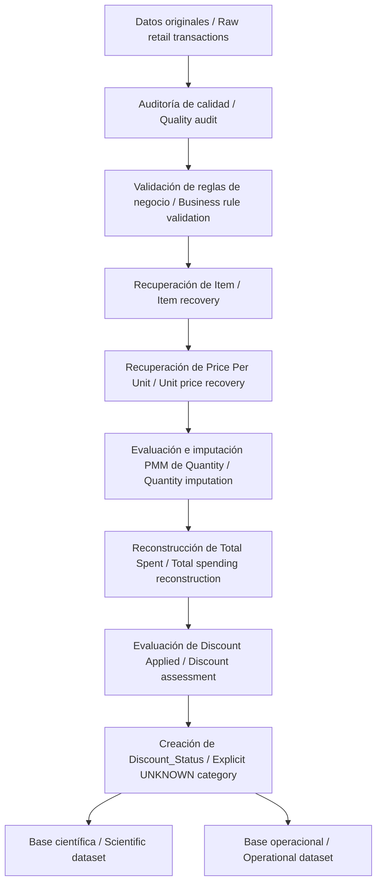

# Retail Store Sales — Data Quality, Cleaning & Imputation

**Informe metodológico de auditoría, limpieza e imputación de datos / Methodological Report on Data Auditing, Cleaning, and Imputation**

Proyecto de ciencia de datos aplicado al conjunto **Retail Store Sales: Dirty for Data Cleaning**. Se analizan **12.575 transacciones y 11 variables originales** para identificar datos faltantes, validar reglas de negocio, recuperar información cuando es posible e imputar estadísticamente solo los valores que cuentan con una justificación metodológica.

*Data science project focused on auditing 12,575 retail transactions, applying validated business rules, assessing statistical imputation methods, and retaining uncertainty when reliable recovery is not possible.*

## 1. Objetivo / Objective

Construir un procedimiento documentado y trazable para tratar datos transaccionales incompletos sin confundir **recuperación determinística**, **estimación estadística** y **valores desconocidos**. El proyecto emplea **Python** para auditoría y limpieza basada en reglas y **R** para evaluación e imputación estadística.

## 2. Resultados principales / Key results

| Indicador / Indicator | Resultado / Result |
|---|---:|
| Transacciones originales y finales / Original and final transactions | **12.575** |
| Valores de `Item` recuperados / Recovered `Item` values | **1.213** |
| Valores de `Price Per Unit` recuperados / Recovered unit prices | **609** |
| Recuperaciones determinísticas en Python / Deterministic recoveries in Python | **1.822** |
| Valores de `Quantity` imputados mediante PMM / PMM-imputed quantities | **604** |
| Valores de `Total Spent` reconstruidos / Reconstructed total spending values | **604** |
| Valores de `Discount Applied` mantenidos como desconocidos / Discount values retained as unknown | **4.199** |
| Transacciones eliminadas / Deleted transactions | **0** |

**Precisión:** las 1.822 recuperaciones determinísticas son la suma de 1.213 valores de `Item` y 609 de `Price Per Unit`; no son un grupo adicional. Los recuentos corresponden a *valores tratados*, no necesariamente a transacciones diferentes.

## 3. Arquitectura del repositorio / Repository structure

La estructura siguiente reproduce los nombres **visibles en las capturas**. Algunos directorios no fueron abiertos, por lo que se describe su papel probable o se indica que no está verificado.

```text
Retail_Store_Sales_Dirty_for_Data_Cleaning/
├── .git/                              # Historial y metadatos de Git
├── .Rproj.user/                       # Estado local de RStudio; no es código fuente
├── app.py/                            # Carpeta con ese nombre en la captura; contenido no verificado
├── clean_Retail_Store/                # Carpeta visible; contenido no verificado
├── data/
│   ├── raw/
│   │   └── retail_store_sales.csv     # Datos originales de entrada
│   └── processed/
│       ├── retail_sales_pre_imputation.csv
│       ├── retail_sales_pre_imputation.parquet
│       ├── retail_sales_final_scientific.csv
│       ├── retail_sales_final_scientific.parquet
│       ├── retail_sales_final_operational.csv
│       ├── retail_sales_final_operational.parquet
│       ├── total_spent_comparison.csv
│       ├── total_spent_comparison.parquet
│       └── total_spent_comparison.xlsx
├── image/                             # Figuras y visualizaciones del análisis
├── report/
│   ├── 0. Reporte. Proceso_End_to_End_Calidad_Limpieza_Imputacion_Retail_Sales.html
│   ├── 01_data_quality_dirty_retail.html
│   ├── 02_imputation_retail.html
│   ├── 02_imputation_retail.txt
│   ├── Methodological Report on Data Auditing, Cleaning, and Imputation – Retail Store Sales.html
│   └── Methodological Report on Data Auditing, Cleaning, and Imputation – Retail Store Sales.pdf
├── rsconnect/                         # Metadatos de despliegue/publicación de R, si se utilizan
├── src/
│   ├── 01_data_quality_dirty_retail.ipynb
│   └── 02_imputation_retail.Rmd
├── .gitignore
├── .RData                             # Espacio de trabajo local de R
├── .Rhistory                          # Historial local de comandos de R
├── 0_Retail_Store_Sales_Dirty_for_Data_Cleaning.Rproj
├── readme.md                          # README existente; sustituir por este si procede
└── styles.css                         # Hoja de estilos; asociación concreta no verificada
```

> Los archivos de las capturas no fueron adjuntados como código ejecutable. Por tanto, aquí no se documentan funciones internas, parámetros de ejecución ni dependencias específicas que no se han comprobado.

## 4. ¿Qué contiene cada carpeta? / Folder guide

| Ruta / Path | Función / Purpose |
|---|---|
| `data/raw/` | Fuente original. `retail_store_sales.csv` es el punto de partida y debe permanecer sin modificaciones. / Original input dataset. |
| `data/processed/` | Resultados intermedios y finales, en formatos CSV y Parquet, además de una comparación de `Total Spent`. / Intermediate and final datasets. |
| `src/` | Código analítico: notebook Python de auditoría y documento R Markdown de imputación. / Analytical source code. |
| `image/` | Gráficos de diagnóstico, validación, imputación y resultados. / Analytical figures. |
| `report/` | Reportes HTML y PDF, incluyendo el informe metodológico bilingüe. / Reports and documentation. |
| `rsconnect/` | Carpeta asociada habitualmente a publicación desde R; no implica que exista una aplicación desplegada. / R deployment metadata if applicable. |
| `.git/`, `.Rproj.user/` | Metadatos de control de versiones y preferencias locales; no son datos del proyecto. / Git and local RStudio metadata. |
| `app.py/`, `clean_Retail_Store/` | Carpetas visibles cuyo contenido y finalidad exacta requieren revisión. / Visible folders whose contents have not been inspected. |

### Archivos principales / Main files

- **`src/01_data_quality_dirty_retail.ipynb`**: notebook de Python correspondiente a la fase de diagnóstico, auditoría y limpieza determinística, según el nombre del archivo y la metodología descrita.
- **`src/02_imputation_retail.Rmd`**: análisis en R Markdown para la fase de evaluación e imputación de valores faltantes.
- **`data/processed/retail_sales_pre_imputation.*`**: conjunto intermedio previo a la fase de imputación, según su denominación.
- **`data/processed/retail_sales_final_scientific.*`**: base científica, con 12.575 registros, 14 variables y 4.199 valores nulos de `Discount Applied` preservados.
- **`data/processed/retail_sales_final_operational.*`**: base operacional, con 12.575 registros y 13 variables, sin valores nulos; mantiene `Discount_Status = UNKNOWN` cuando corresponde.
- **`data/processed/total_spent_comparison.*`**: archivos de comparación vinculados a `Total Spent`; no se infiere su estructura interna únicamente a partir del nombre.
- **`report/Methodological Report on Data Auditing, Cleaning, and Imputation – Retail Store Sales.pdf`**: documento para lectura y consulta sin ejecutar el código.
- **`report/0. Reporte. Proceso_End_to_End_Calidad_Limpieza_Imputacion_Retail_Sales.html`**: reporte HTML del proceso integral, según su nombre.

## 5. Flujo metodológico / Methodological workflow



**Etapa Python.** Se analizaron la completitud, la cardinalidad, los rangos y las relaciones entre variables. Las reglas validadas incluyeron `Item → Category`, `Item → Price Per Unit` y `Total Spent = Price Per Unit × Quantity`, cuando las condiciones de aplicación permitían utilizarlas. Se recuperaron 1.213 valores de `Item` y 609 precios unitarios.

**Etapa R.** Para `Quantity`, se compararon PMM (*Predictive Mean Matching*), CART y Random Forest. La evaluación ocultó temporalmente 1.197 valores observados (aproximadamente el 10 % de 11.971 valores conocidos), lo que permitió medir el error contra valores reales. PMM fue seleccionado bajo los criterios evaluados. Después se reconstruyeron 604 valores de `Total Spent` a partir de la cantidad imputada y el precio unitario disponible.

**Descuentos.** Para `Discount Applied` se evaluaron regresión logística, CART y Random Forest. Su exactitud fue próxima a la de un clasificador de referencia, por lo que no se imputaron los 4.199 valores ausentes. Se creó `Discount_Status` con `TRUE`, `FALSE` y `UNKNOWN`.

## 6. Validación de la imputación / Imputation validation

| Métrica / Metric | PMM | CART |
|---|---:|---:|
| Exactitud exacta / Exact match accuracy | 9,52 % | 10,1 % |
| Exactitud ±1 unidad / Accuracy within ±1 unit | 29,8 % | 27,3 % |
| Exactitud ±2 unidades / Accuracy within ±2 units | 47,5 % | 44,6 % |
| Error absoluto medio / Mean absolute error (MAE) | 3,20 | 3,45 |
| Raíz del error cuadrático medio / Root mean squared error (RMSE) | 3,98 | 4,27 |
| Sesgo / Bias | −0,016 | −0,042 |

Aunque PMM muestra mejores resultados que CART en MAE, RMSE y tolerancias ±1/±2 en estos ensayos, **el error individual continúa siendo considerable**. La reconstrucción posterior de `Total Spent` depende de las cantidades imputadas y hereda esa incertidumbre. El informe también menciona Random Forest; esta tabla no le atribuye métricas no suministradas.

## 7. Dos conjuntos finales / Two final datasets

| Característica / Characteristic | Científica / Scientific | Operacional / Operational |
|---|---|---|
| Registros / Records | 12.575 | 12.575 |
| Variables / Variables | 14 | 13 |
| Valores faltantes / Missing values | 4.199 | 0 |
| Incluye `Discount Applied` / Retains `Discount Applied` | Sí / Yes | No / No |
| Incluye `Discount_Status` / Retains `Discount_Status` | Sí / Yes | Sí / Yes |
| Uso / Intended use | Investigación y trazabilidad / Research and traceability | Reportes y análisis / Reporting and analysis |

**`UNKNOWN` no significa `FALSE`.** La base operacional no tiene valores nulos porque excluye `Discount Applied`, pero mantiene los 4.199 casos desconocidos identificados por `Discount_Status`. La ausencia de nulos no equivale a conocer todos los descuentos.

## 8. Cómo explorar el proyecto / How to explore

1. Leer el [informe metodológico en PDF](report/Methodological%20Report%20on%20Data%20Auditing%2C%20Cleaning%2C%20and%20Imputation%20%E2%80%93%20Retail%20Store%20Sales.pdf) para comprender decisiones, validaciones y resultados.
2. Abrir [`src/01_data_quality_dirty_retail.ipynb`](src/01_data_quality_dirty_retail.ipynb) para revisar la fase Python.
3. Abrir [`src/02_imputation_retail.Rmd`](src/02_imputation_retail.Rmd) en RStudio para revisar el análisis estadístico.
4. Consultar `data/processed/` para comparar la base previa a imputación y las dos versiones finales.
5. Revisar `image/` y `report/` para encontrar las figuras y los reportes elaborados.

**Reproducción:** el orden lógico es ejecutar primero la fase Python y luego la fase R. Las capturas y el informe no permiten confirmar versiones de Python/R, bibliotecas requeridas, directorio de trabajo ni instrucciones exactas de ejecución. Antes de presentar comandos reproducibles es necesario verificar el código de ambos archivos y fijar sus dependencias (por ejemplo, mediante un archivo de entorno y un registro de sesión).

## 9. Limitaciones / Limitations

- Las reglas determinísticas son válidas únicamente cuando se cumplen los supuestos verificados en los registros disponibles; los descuentos y otros ajustes pueden afectar la identidad aritmética utilizada.
- Una imputación puede conservar estadísticas descriptivas y, aun así, estimar incorrectamente transacciones individuales.
- La selección de PMM se fundamenta en las métricas documentadas, no en una reconstrucción exacta de todas las cantidades.
- Los registros `UNKNOWN` representan información no observada, no una tercera modalidad real de descuento.
- Los resultados proceden de un conjunto creado para practicar problemas de calidad; no constituyen evidencia sobre un establecimiento comercial real.

## 10. Tecnologías / Technologies

**Python**, **Jupyter Notebook**, **R**, **R Markdown**, **RStudio**, **CSV**, **Parquet**, **HTML** y **PDF**. Los paquetes específicos y sus versiones deben verificarse en el código fuente antes de documentarlos.

## 11. Fuente de datos y créditos / Data source and credits

**Dataset:** *Retail Store Sales: Dirty for Data Cleaning*.

**Referencia incluida en el informe / Reference listed in the report:** [Mahmoud Gamil — Kaggle notebook](https://www.kaggle.com/code/mahmoudredagamail/r). El enlace identifica una referencia presente en la documentación suministrada; debe verificarse por separado la URL exacta de descarga y la licencia del dataset antes de redistribuirlo.

**Informe y análisis / Report and analysis:** John Jairo Prado.

---

**Criterio metodológico / Methodological principle:** recuperar cuando exista una relación verificable, imputar cuando la evaluación lo respalde y preservar como desconocida la información que no pueda determinarse de forma confiable.
